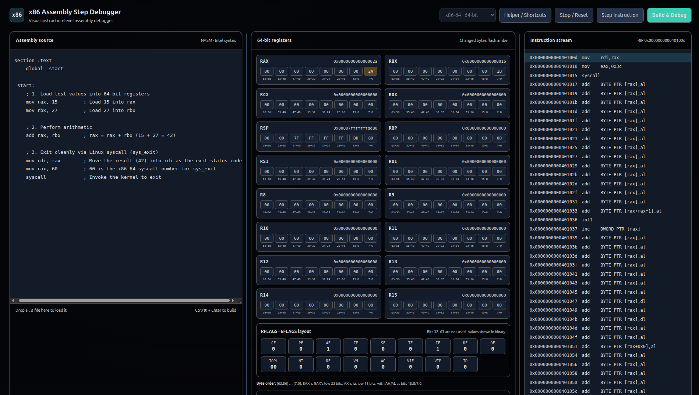

# x86 Assembly Step Debugger



A lightweight, browser-based instruction debugger for **32-bit i386** and
**64-bit x86-64** Linux assembly. Write or drop in NASM source, build it with
NASM and GNU `ld`, then step through machine instructions while watching the
program counter, general-purpose registers, flags, and individual register
bytes update.

The application uses only Python's standard library on the server and plain
HTML, CSS, and JavaScript in the browser. It has no Python packages, JavaScript
packages, build step, or external assets.

## Features

- Switch between i386 and x86-64 assembly modes in the application.
- Assemble NASM ELF objects and link standalone Linux executables.
- Step one instruction at a time through GDB's Machine Interface.
- View disassembly around the current instruction and highlight the PC.
- Inspect general-purpose registers and EFLAGS/RFLAGS as byte-level values.
- Highlight only the bytes that changed after a step.
- Convert unsigned decimal, hexadecimal, and binary values at 8-, 16-, 32-,
  or 64-bit widths.
- View the source, registers, and instruction stream side by side; drag the
  dividers (or focus one and use the arrow keys) to resize the panels.
- Edit source in the browser or drag and drop a `.s` file into the editor.
- Use keyboard shortcuts: **Space** or **Right Arrow** to step; **Ctrl/⌘ +
  Enter** to build.

## Requirements

On Ubuntu, install Python 3 and the native tools:

```bash
sudo apt update
sudo apt install python3 nasm binutils gdb
```

The 64-bit mode requires an x86-64 Ubuntu host and an `ld` that supports the
`elf_x86_64` emulation. The 32-bit mode emits a standalone i386 ELF executable;
it does not require 32-bit C libraries.

## Run

Clone or download the repository, then start the server from the project
directory:

```bash
python3 server.py
```

Open [http://127.0.0.1:8000](http://127.0.0.1:8000) in your browser. Select
**i386 · 32-bit** or **x86-64 · 64-bit**, enter assembly, and click
**Build & Debug**. While a session is active, use **Step Instruction** or
**Stop / Reset**. Reset the current session before changing architecture.

On wide screens, the editor, register view, and instruction stream appear in
that order from left to right. Drag either divider to resize neighboring
panels. At narrower viewport sizes the panels stack vertically.
The initial width weights are 35:40:30; they are normalized to fit because
the ratios add up to more than 100%.

## Example programs

Each mode expects NASM Intel syntax and a global `_start` entry point. The
examples below exit cleanly using the Linux system-call ABI for their
architecture.

### i386

```nasm
global _start

section .text
_start:
    mov eax, 1          ; sys_exit
    mov ebx, 42         ; exit status
    int 0x80
```

The server assembles this mode with `nasm -f elf` and links it with
`ld -m elf_i386`.

### x86-64

```nasm
global _start

section .text
_start:
    mov rax, 60         ; sys_exit
    mov rdi, 42         ; exit status
    syscall
```

The server assembles this mode with `nasm -f elf64` and links it with
`ld -m elf_x86_64`.

## Register display

The i386 view includes EAX, EBX, ECX, EDX, ESP, EBP, ESI, EDI, and EFLAGS.
The x86-64 view includes RAX–RDI, R8–R15, and RFLAGS. Each register is split
into 8-bit hex blocks in most-significant-to-least-significant order. For
example, the low 32 bits of RAX are EAX, its low 16 bits are AX, and its low
two bytes can be addressed as AH and AL.

The condition and control flags are displayed separately as individual binary
bits below the general-purpose registers. The x86-64 view uses the same
EFLAGS bit layout for RFLAGS and notes that its upper 32 bits are not used.

Signed results are shown as their fixed-width hexadecimal register values
(for example, `-2` in EAX appears as `0xfffffffe`). If an instruction stops
the program on a signal, the debugger reports the signal and preserves the
stopped register state; stepping again delivers the signal to the process.

## Run tests

The numeric parsing and GDB stop-state regression tests use Python's built-in
`unittest` runner:

```bash
python3 -m unittest discover -s tests -v
```

## Security note

Assembly programs execute as native processes with the permissions of the
user running the server. Only use source you trust. The server binds to
`127.0.0.1` by default; do not expose it to an untrusted network.

## License

See [LICENSE](LICENSE).
